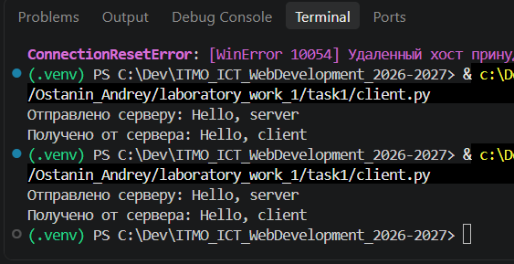
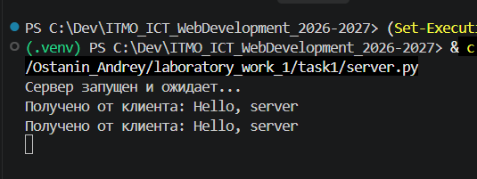
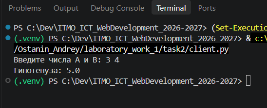
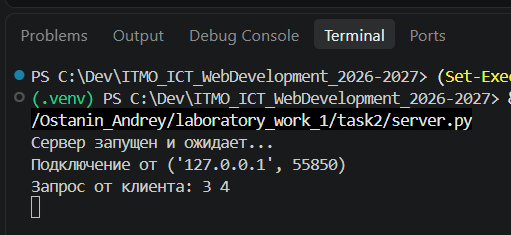
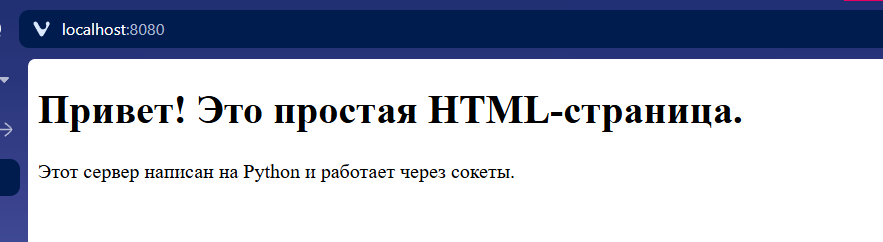
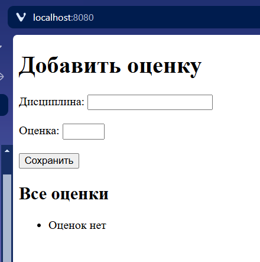
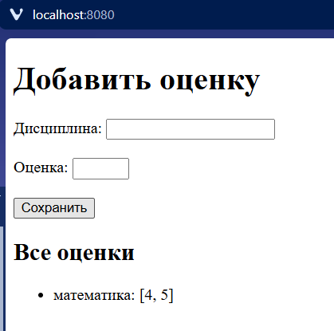
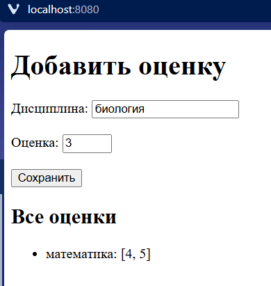
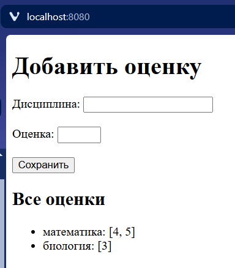

# Лабораторная 1
## Практическое задание 1
Реализовать клиентскую и серверную часть приложения. Клиент отправляет серверу сообщение «Hello, server», и оно должно отобразиться на стороне сервера. В ответ сервер отправляет клиенту сообщение «Hello, client», которое должно отобразиться у клиента.

```python
# Серверная часть

import socket

# Создание сокета
server_socket = socket.socket(socket.AF_INET, socket.SOCK_DGRAM) # UDP
server_socket.bind(('localhost', 8080))

print("Сервер запущен и ожидает...")

# Получение и отправление данных
while True:
    data, client_address = server_socket.recvfrom(1024)
    print(f"Получено от клиента: {data.decode('utf-8')}")
    
    server_socket.sendto(b"Hello, client", client_address)
```

```python
# Клиентская часть

import socket

client_socket = socket.socket(socket.AF_INET, socket.SOCK_DGRAM)

server_address = ('localhost', 8080)

# Отправка сообщения
message = "Hello, server"
client_socket.sendto(message.encode('utf-8'), server_address)
print(f"Отправлено серверу: {message}")

# Получение ответа от сервера
data, server = client_socket.recvfrom(1024)
response = data.decode('utf-8')
print(f"Получено от сервера: {response}")

client_socket.close()
```

Проверка работоспособности:

Клиент <br>


Сервер <br>


## Практическое задание 2
Реализовать клиентскую и серверную часть приложения. Клиент запрашивает выполнение математической операции, параметры которой вводятся с клавиатуры. Сервер обрабатывает данные и возвращает результат клиенту.

Мой вариант выпал на теорему Пифагора

```python
# Клиент

import socket

input_data = input("Введите числа A и B: ")

# Создание TCP сокета
client_socket = socket.socket(socket.AF_INET, socket.SOCK_STREAM)
client_socket.connect(('localhost', 8080))

client_socket.sendall(input_data.encode())

response = client_socket.recv(1024).decode()
print(f"Гипотенуза: {response}")

client_socket.close()
```

```python
# Сервер

import socket
import math

# Создание TCP сокета
server_socket = socket.socket(socket.AF_INET, socket.SOCK_STREAM)
server_socket.bind(('localhost', 8080))
server_socket.listen(1)
print("Сервер запущен и ожидает...")

while True:
    # Установление соединения с клиентом
    client_connection, client_address = server_socket.accept()
    print(f"Подключение от {client_address}")

    request = client_connection.recv(1024).decode()
    print(f"Запрос от клиента: {request}")

    # Считаем теорему Пифагора
    a, b = map(int, request.split())
    c = math.sqrt(a**2 + b**2)

    # Отправка результата подключенным соединениям
    client_connection.sendall(str(c).encode())
    client_connection.close()
```

Проверка работоспособности:

Клиент <br>


Сервер <br>


## Практическое задание 3
Реализовать серверную часть приложения. Клиент подключается к серверу и в ответ получает HTTP-сообщение, содержащее HTML-страницу, которую сервер подгружает из файла index.html.

Код для серверной части, в которой я создаю сокет по TCP и отправляю подключенному клиенту html страницу и необходимые заголовки
```python
import socket
from pathlib import Path

HOST = 'localhost'
PORT = 8080

server_socket = socket.socket(socket.AF_INET, socket.SOCK_STREAM)

server_socket.bind((HOST, PORT))  

server_socket.listen(5)
print(f"HTTP сервер запущен на {HOST}:{PORT}...")

html_bytes = Path(__file__).parent.joinpath('index.html').read_bytes()

while True:
    client_connection, client_address = server_socket.accept()
    print(f'Подключение от {client_address}')

    request = client_connection.recv(2048).decode()
    print(f'Запрос клиента:\n{request}')

    headers = (
        "HTTP/1.1 200 OK\r\n"
        "Content-Type: text/html; charset=UTF-8\r\n"
        f"Content-Length: {len(html_bytes)}\r\n"
        "Connection: close\r\n"
        "\r\n"
    ).encode('utf-8')

    client_connection.sendall(headers + html_bytes)
    client_connection.close()
```

А также index.html
```html
<!DOCTYPE html>
<html>
<head>
    <title>Простой сервер на Python</title>
</head>
<body>
    <h1>Привет! Это простая HTML-страница.</h1>
    <p>Этот сервер написан на Python и работает через сокеты.</p>
</body>
</html>
"""
```

Страница выводится нормально <br>


## Практическое задание 4
Реализовать двухпользовательский или многопользовательский чат.

Весь код для сервера целиком:
```python
import socket
import threading

HOST = 'localhost'
PORT = 8080

server_socket = socket.socket(socket.AF_INET, socket.SOCK_STREAM)
server_socket.setsockopt(socket.SOL_SOCKET, socket.SO_REUSEADDR, 1)
server_socket.bind((HOST, PORT))
server_socket.listen()

lock = threading.Lock()

# Словарь {socket: username} — хранит активных пользователей
clients = {}

print(f"Сервер запущен на {HOST}:{PORT}")

def broadcast(message, exclude=None):
    """Рассылает сообщение всем, кроме отправителя."""
    with lock:
        for client in list(clients.keys()):
            if client is exclude:
                continue
            try:
                client.sendall(message.encode('utf-8'))
            except OSError:
                client.close()
                clients.pop(client, None)

def handle_client(client_socket, address):
    try:
        nickname = client_socket.recv(1024).decode('utf-8').strip()

        with lock:
            clients[client_socket] = nickname

        print(f"[+] {nickname} подключился ({address})")
        broadcast(f"*** {nickname} присоединился к чату ***", exclude=client_socket)

        while True:
            data = client_socket.recv(1024)
            if not data:
                break

            message = data.decode('utf-8').strip()

            # Команда выхода
            if message.lower() == '/exit':
                break

            print(f"{nickname}: {message}")
            broadcast(f"{nickname}: {message}", exclude=client_socket)

    except:
        pass
    finally:
        with lock:
            clients.pop(client_socket, None)
        try:
            client_socket.close()
        except:
            pass
        print(f"[-] {nickname if 'nickname' in dir() else address} отключился")
        broadcast(f"*** {nickname} покинул чат ***")


while True:
    client_socket, address = server_socket.accept()
    thread = threading.Thread(target=handle_client, args=(client_socket, address), daemon=True)
    thread.start()
```

Далее разберем код по блокам

1) Инициализовация сокета
```python
HOST = 'localhost'
PORT = 8080

server_socket = socket.socket(socket.AF_INET, socket.SOCK_STREAM)
server_socket.setsockopt(socket.SOL_SOCKET, socket.SO_REUSEADDR, 1)
server_socket.bind((HOST, PORT))
server_socket.listen()
```

2) Здесь мы защищаем словарь client от состояния гонки
```python
lock = threading.Lock()
```

3) Функция, которая рассылает сообщение всем, кроме отправителя.
```python
def broadcast(message, exclude=None):
    with lock:
        for client in list(clients.keys()):
            if client is exclude:
                continue
            try:
                client.sendall(message.encode('utf-8'))
            except OSError:
                client.close()
                clients.pop(client, None)
```

4) Теперь рассмотрим функцию ```handle_client```
```python
def handle_client(client_socket, address):
    try:
        # Первым сообщением получаем имя пользователя
        nickname = client_socket.recv(1024).decode('utf-8').strip()

        # Добавляем нового пользователя в чат
        with lock:
            clients[client_socket] = nickname

        print(f"[+] {nickname} подключился ({address})")

        # Рассылка о новом участнике чата
        broadcast(f"*** {nickname} присоединился к чату ***", exclude=client_socket)

        # Цикл обработки сообщений от конкретного клиента в его отдельном потоке
        while True:
            data = client_socket.recv(1024)
            if not data:
                break

            message = data.decode('utf-8').strip()

            # Команда выхода
            if message.lower() == '/exit':
                break

            print(f"{nickname}: {message}")
            broadcast(f"{nickname}: {message}", exclude=client_socket)
    except:
        pass
    finally:
        with lock:
            clients.pop(client_socket, None)
        try:
            client_socket.close()
        except:
            pass
        print(f"[-] {nickname if 'nickname' in dir() else address} отключился")
        broadcast(f"*** {nickname} покинул чат ***")

```

5) Инициализация соединения в новом потоке для новых пользователей
```python
while True:
    client_socket, address = server_socket.accept()
    thread = threading.Thread(target=handle_client, args=(client_socket, address), daemon=True)
    thread.start()
```


Также есть клиент.  
```python
import socket
import sys
import threading

HOST = 'localhost'
PORT = 8080

username = input('Введите ваш username: ')

client_socket = socket.socket(socket.AF_INET, socket.SOCK_STREAM)
client_socket.connect((HOST, PORT))

# Отправляем серверу свой ник первым сообщением
client_socket.sendall(username.encode('utf-8'))

def receive_messages():
    while True:
        try:
            data = client_socket.recv(1024)
            if not data:
                print("\nСоединение закрыто сервером.")
                break
            print(data.decode('utf-8'))
        except OSError:
            break
    client_socket.close()
    sys.exit(0)

threading.Thread(target=receive_messages, daemon=True).start()

print("Вы в чате. Напишите /exit, чтобы выйти.")

while True:
    try:
        message = input()
    except:
        break

    if message.lower()  == '/exit':
        break

    try:
        client_socket.sendall(message.encode('utf-8'))
    except:
        break

client_socket.close()
print("Вы вышли из чата.")
```

## Практическое задание 5
Написать простой веб-сервер для обработки GET и POST HTTP-запросов с помощью библиотеки socket в Python. Сервер должен:

- Принимать и записывать информацию о дисциплине и оценке по дисциплине.
- Отдавать информацию обо всех оценках по дисциплинам в виде HTML-страницы.

Весь код серверной части
```python
from pathlib import Path
import socket
from urllib.parse import parse_qs

HOST = 'localhost'
PORT = 8080

grades = {}

TEMPLATE = Path(__file__).parent.joinpath('index.html').read_text(encoding='utf-8')

server_socket = socket.socket(socket.AF_INET, socket.SOCK_STREAM)
server_socket.setsockopt(socket.SOL_SOCKET, socket.SO_REUSEADDR, 1)
server_socket.bind((HOST, PORT))
server_socket.listen()

print("Сервер запущен по адресу: localhost:8080 и ожидает...")


def render_page():
    if not grades:
        items = "<li>Оценок нет</li>"
    else:
        items = "".join(
            f"<li>{subject}: {marks}</li>" for subject, marks in grades.items()
        )
    return TEMPLATE.replace("{{GRADES}}", items)


def parse_request(request):
    head, _, body = request.partition(b"\r\n\r\n")
    print(request)
    lines = head.decode('utf-8').split("\r\n")

    method, path, _ = lines[0].split()
    headers = {}
    for line in lines[1:]:
        if ':' in line:
            k, v = line.split(':', 1)
            headers[k.strip().lower()] = v.strip()

    return method, path, headers, body


def make_response(status, body, content_type="text/html; charset=utf-8"):
    headers = (
        f"HTTP/1.1 {status}\r\n"
        f"Content-Type: {content_type}\r\n"
        f"Content-Length: {len(body)}\r\n"
        "Connection: close\r\n"
        "\r\n"
    ).encode('utf-8')
    return headers + body


while True:
    client_connection, client_address = server_socket.accept()
    print(f"Подключение от {client_address}")

    try:
        request = client_connection.recv(1024)

        method, path, headers, body = parse_request(request)

        print(f"{method} {path}")

        if method == "GET" and path == "/":
            response = make_response("200 OK", render_page().encode('utf-8'))

        elif method == "POST" and path == "/":
            params = parse_qs(body.decode('utf-8'))
            subject = params.get('subject', [''])[0].strip()
            grade = params.get('grade', [''])[0].strip()

            if subject and grade.isdigit():
                if subject not in grades:
                    grades[subject] = []
                grades[subject].append(int(grade))
                print(f"Сохранено: {subject} = {grade}")

            redirect_headers = (
                "HTTP/1.1 303 See Other\r\n"
                "Location: /\r\n"
                "Content-Length: 0\r\n"
                "Connection: close\r\n"
                "\r\n"
            ).encode('utf-8')
            response = redirect_headers

        else:
            response = make_response(
                "404 Not Found",
                b"<h1>404 Not Found</h1>",
            )

        client_connection.sendall(response)

    except Exception as e:
        print(f"Ошибка обработки запроса: {e}")
    finally:
        client_connection.close()
```

И html шаблон
```html
<!DOCTYPE html>
<html lang="ru">
<head>
    <meta charset="UTF-8">
    <title>Оценки по дисциплинам</title>
</head>
<body>
    <h1>Добавить оценку</h1>
    <form method="POST" action="/">
        <label>Дисциплина: <input type="text" name="subject" required></label><br><br>
        <label>Оценка: <input type="number" name="grade" min="1" max="5" required></label><br><br>
        <button type="submit">Сохранить</button>
    </form>

    <h2>Все оценки</h2>
    <ul>
        {{GRADES}}
    </ul>
</body>
</html>
```

Далее также разберем важные моменты из кода

1) Рендер страницы уже с оценками
```python
def render_page():
    if not grades:
        items = "<li>Оценок нет</li>"
    else:
        items = "".join(
            f"<li>{subject}: {marks}</li>" for subject, marks in grades.items()
        )
    return TEMPLATE.replace("{{GRADES}}", items)
```

2) ```parse_request``` разбирает сырой HTTP-запрос в удобные части
```python
def parse_request(request):
    head, _, body = request.partition(b"\r\n\r\n")
    print(request)
    lines = head.decode('utf-8').split("\r\n")

    method, path, _ = lines[0].split()
    headers = {}
    for line in lines[1:]:
        if ':' in line:
            k, v = line.split(':', 1)
            headers[k.strip().lower()] = v.strip()

    return method, path, headers, body
```

3) ```make_response``` собирает корректный HTTP-ответ из частей
```python
def make_response(status, body, content_type="text/html; charset=utf-8"):
    headers = (
        f"HTTP/1.1 {status}\r\n"
        f"Content-Type: {content_type}\r\n"
        f"Content-Length: {len(body)}\r\n"
        "Connection: close\r\n"
        "\r\n"
    ).encode('utf-8')
    return headers + body
```

4) Главный цикл для обработки запросов
```python
while True:
    client_connection, client_address = server_socket.accept()
    print(f"Подключение от {client_address}")

    try:
        request = client_connection.recv(1024)

        method, path, headers, body = parse_request(request)

        print(f"{method} {path}")

        # Отдать страницу по GET методу
        if method == "GET" and path == "/":
            response = make_response("200 OK", render_page().encode('utf-8'))

        # Принять новую оценку
        elif method == "POST" and path == "/":
            params = parse_qs(body.decode('utf-8'))
            subject = params.get('subject', [''])[0].strip()
            grade = params.get('grade', [''])[0].strip()

            # Добавление оценки
            if subject and grade.isdigit():
                # # Проверяет, что дисциплина не пустая и оценка — число. Если такой дисциплины ещё нет, то создает
                if subject not in grades:
                    grades[subject] = []
                grades[subject].append(int(grade))
                print(f"Сохранено: {subject} = {grade}")


            redirect_headers = (
                "HTTP/1.1 303 See Other\r\n"
                "Location: /\r\n"
                "Content-Length: 0\r\n"
                "Connection: close\r\n"
                "\r\n"
            ).encode('utf-8')
            response = redirect_headers

        # При иных запросах
        else:
            response = make_response(
                "404 Not Found",
                b"<h1>404 Not Found</h1>",
            )

        client_connection.sendall(response)

    except Exception as e:
        print(f"Ошибка обработки запроса: {e}")
    finally:
        client_connection.close()
```

Проверка работоспособности







